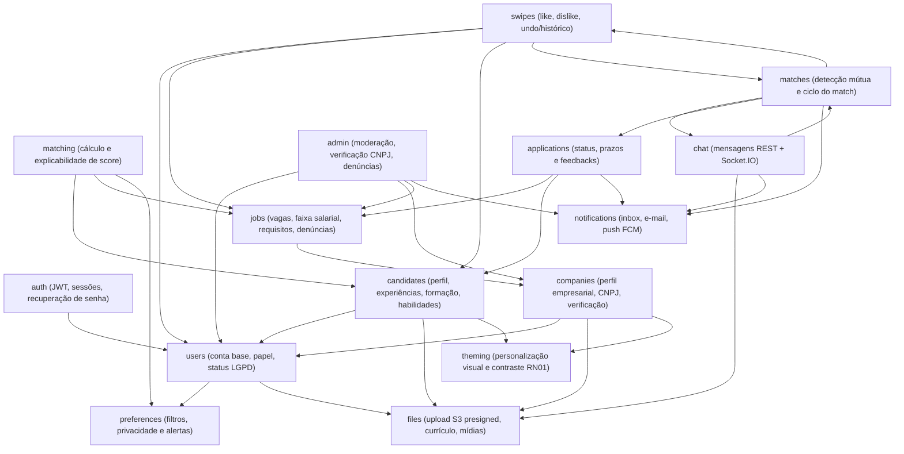
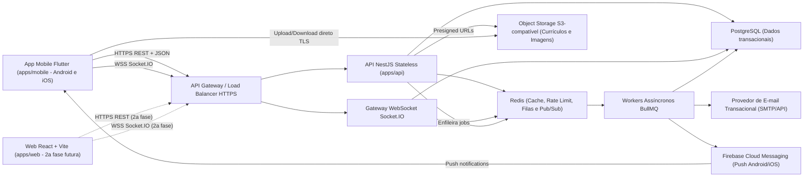
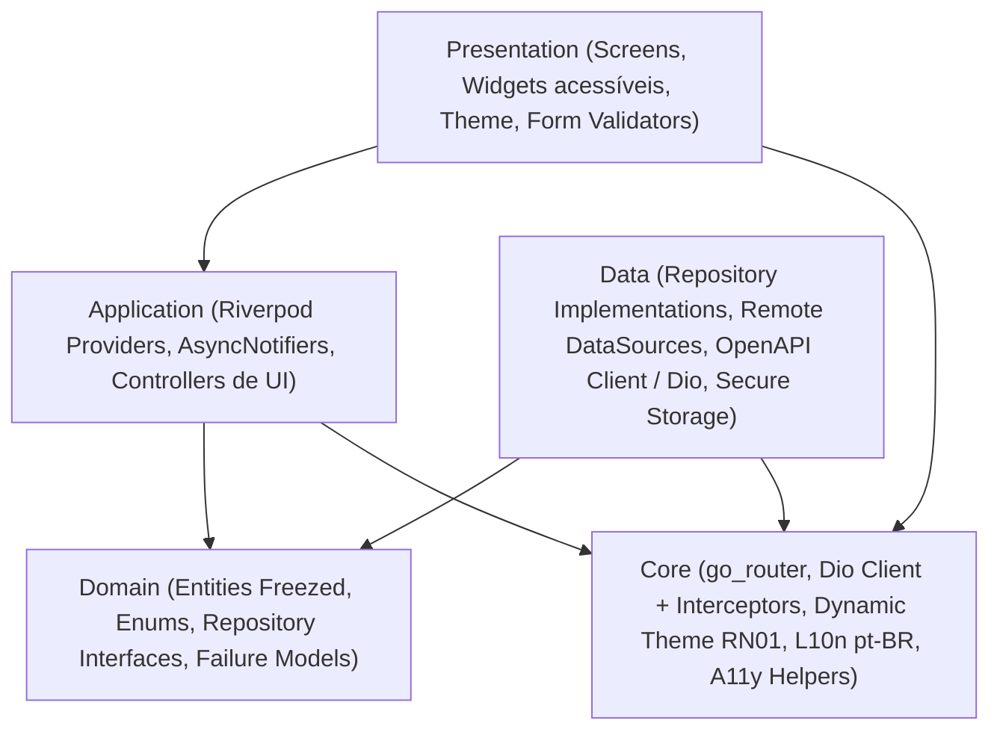

# Arquitetura do Sistema — Plataforma de Recrutamento (Job Keep)

> **Status:** Proposta inicial (1ª fase: API + App Flutter; 2ª fase futura: Web React + Painel Admin)  
> **Idioma da documentação:** Português do Brasil (identificadores de código, arquivos e contratos em inglês)

---

## 1. Stack e Justificativa

### 1.1 Estrutura em Monorepo

O repositório adotará uma organização em **monorepo**, mantendo os aplicativos isolados por domínio de execução e compartilhando contratos e documentação na raiz:

- `apps/api`: backend em **TypeScript estrito** com **NestJS**, **Prisma ORM**, **PostgreSQL**, **Redis**, **BullMQ** e **Socket.IO**.
- `apps/mobile`: aplicativo **Flutter** (Dart _null-safe_) único para **Android e iOS**, atendendo candidatos e empresas no mesmo binário, com interface adaptada ao papel do usuário autenticado.
- `apps/web`: **reservado apenas na documentação** para a 2ª fase (**React + Vite** e painel administrativo web). **Não será criado nesta fase.**
- `docs/`: documentação arquitetural, especificações OpenAPI exportadas (`docs/openapi/openapi.json`) e guias operacionais.

**Justificativa do monorepo:** facilita o versionamento sincronizado entre o contrato OpenAPI gerado pela API e o cliente Dart consumido pelo aplicativo mobile, além de permitir pipelines de CI/CD coordenados com um único histórico de PRs e _Conventional Commits_.

---

### 1.2 Backend: Monólito Modular vs. Microsserviços

O backend será construído como um **Monólito Modular** com **API _stateless_ (JWT)**, preparado para **escala horizontal** atrás de um balanceador de carga HTTPS.

#### Por que Monólito Modular e não Microsserviços?

1. **Transações ACID em fluxos críticos interligados:** um único _swipe_ positivo pode disparar, de forma atômica, a gravação do swipe, a detecção de _match_ mútuo, a criação da candidatura (`Application`) com prazo de resposta, a abertura da sala de conversa (`Conversation`) e o agendamento de notificações (`Notification`). Em um monólito modular com PostgreSQL único e Prisma (`$transaction`), toda a consistência transacional é garantida nativamente sem _Sagas_ distribuídas, compensações complexas ou risco de estados parciais (_split-brain_ entre match sem chat ou candidatura sem status).
2. **Latência previsível (RNF08 < 2 s):** chamadas entre domínios (ex.: `swipes` -> `matching` -> `matches` -> `chat` -> `applications`) ocorrem em memória via serviços e eventos internos, evitando saltos de rede, serialização repetida e _timeouts_ em cascata.
3. **Menor custo operacional e maior velocidade de entrega:** apenas um serviço HTTP e workers assíncronos para implantar, monitorar, versionar e depurar, mantendo 99%+ de disponibilidade (RNF09) com menor superfície de falha.
4. **Escalabilidade horizontal preservada (RNF11):** a API é _stateless_ (autenticação via JWT de acesso + refresh token rotacionado no banco/Redis), o WebSocket (`Socket.IO`) usa `@socket.io/redis-adapter` para sincronizar eventos entre réplicas e tarefas pesadas (envio de e-mail, push FCM, recomputação de scores, limpeza LGPD) rodam em workers BullMQ desacoplados via Redis.
5. **Fronteiras preparadas para extração futura:** cada módulo comunica-se por interfaces de serviço bem definidas e eventos de domínio; caso um subdomínio (como `matching` ou `chat`) demande escala independente no futuro, pode ser extraído com baixo acoplamento.

---

### 1.3 Contrato OpenAPI como Fonte Única da Verdade

- O **NestJS** (`@nestjs/swagger` + DTOs com `class-validator` e `class-transformer`) gera automaticamente a especificação **OpenAPI 3.0/3.1** diretamente a partir dos controllers e DTOs tipados.
- A especificação é exportada em `docs/openapi/openapi.json` e validada em CI a cada alteração da API.
- **Mobile (`apps/mobile`):** o cliente HTTP e os modelos de transporte são gerados a partir do OpenAPI (`openapi-generator` com gerador `dart-dio` ou equivalente compatível com `json_serializable`/`Freezed`), eliminando divergências manuais de payload entre backend e app.
- **Web futura (`apps/web`):** consumirá o mesmo contrato via gerador TypeScript (`openapi-typescript` / `orval`), garantindo que nenhuma regra de negócio precise ser duplicada nos clientes.

---

### 1.4 Stack do Aplicativo Mobile (Flutter)

- **Arquitetura _feature-first_ em camadas:** `presentation`, `application`, `domain` e `data`, garantindo isolamento entre UI, controle de estado, contratos de domínio e integração com API/armazenamento local.
- **Gerência de estado e DI (`Riverpod`):** `flutter_riverpod` / `riverpod_annotation` para reatividade previsível, testabilidade por _override_ de providers e injeção de dependência sem acoplamento ao `BuildContext`.
- **Navegação (`go_router`):** roteamento declarativo com redirecionamento por estado de autenticação, papel do usuário (`CANDIDATE` vs. `COMPANY`), verificação de versão mínima do app e suporte futuro a _deep links_ (push de match/mensagem).
- **Rede (`Dio` com interceptors):**
  - Injeção automática de `Authorization: Bearer <accessToken>` e cabeçalhos de cliente (`X-App-Version`, `X-Platform`, `X-Request-Id`).
  - Interceptor de renovação de token (_refresh lock_): ao receber `401`, enfileira requisições concorrentes, executa um único refresh, atualiza os tokens no armazenamento seguro e reenvia as chamadas; se o refresh falhar, encerra a sessão.
  - Interceptor de atualização obrigatória: ao receber `426 Upgrade Required`, redireciona o usuário para a tela de atualização mínima.
- **Modelos imutáveis (`Freezed` + `json_serializable`):** imutabilidade, igualdade por valor, _union types_ para estados assíncronos e serialização segura _null-safe_.
- **Armazenamento seguro (`flutter_secure_storage`):** guarda `accessToken` e `refreshToken` usando Keystore (Android) e Keychain (iOS), sem nunca armazenar senhas em texto claro.
- **Tempo real (`socket_io_client`):** conexão autenticada via JWT para chat pós-match, confirmação de entrega/leitura e indicador de digitação.
- **Push notifications (`firebase_messaging`):** registro de token FCM por dispositivo, recepção em primeiro e segundo plano e roteamento para match, mensagem ou atualização de candidatura.
- **Localização e acessibilidade (`flutter_localizations` + `intl`):** suporte nativo a `pt-BR` para textos, datas, moedas (BRL) e mensagens claras alinhadas à WCAG 2.1 AA.

---

## 2. Módulos do Backend (Monólito Modular)

O backend em `apps/api` é organizado em **15 módulos de domínio**, apoiados por módulos transversais de infraestrutura (`prisma`, `redis`, `queue`, `config`, `health`, `logger`).



### Responsabilidades por Módulo

| Módulo          | Responsabilidade principal                                                                                                                                     | Requisitos atendidos    |
| --------------- | -------------------------------------------------------------------------------------------------------------------------------------------------------------- | ----------------------- |
| `auth`          | Registro, login, logout, rotação de refresh token, recuperação de senha, verificação de versão mínima do app                                                   | RF01–RF04, RNF05, RNF12 |
| `users`         | Entidade base de usuário, papel (`CANDIDATE`, `COMPANY`, `ADMIN`), encerramento, anonimização e exclusão LGPD                                                  | RF01, RF02, RF18, RNF07 |
| `candidates`    | Perfil profissional, pretensão salarial, modalidade preferida, experiências, formação e habilidades                                                            | RF05, RF06              |
| `companies`     | Perfil empresarial, validação de formato/unicidade de CNPJ, status de verificação e apresentação institucional                                                 | RF02, RF07              |
| `jobs`          | CRUD de vagas com transparência obrigatória (faixa salarial, benefícios, requisitos, modalidade), filtros e denúncia de vaga suspeita                          | RF08, RF15              |
| `matching`      | Motor de compatibilidade explicável (pesos por habilidades, senioridade, faixa salarial, localização e modalidade) e ranking de vagas/candidatos               | RF09, RF11, RNF08       |
| `swipes`        | Registro atômico de `LIKE` / `DISLIKE` do candidato em vaga e da empresa em candidato, evitando duplicidade e reexibição imediata                              | RF10, RF11              |
| `matches`       | Verificação de interesse mútuo, criação transacional do `Match`, abertura da conversa e vínculo com candidatura                                                | RF12                    |
| `chat`          | Histórico paginado por cursor via REST e troca de mensagens em tempo real via Socket.IO apenas entre participantes de um match ativo                           | RF13                    |
| `applications`  | Máquina de estados da candidatura (status visível, prazos de resposta da empresa, alertas de expiração e feedback obrigatório)                                 | RF14                    |
| `notifications` | Central de notificações in-app, enfileiramento no BullMQ e despacho assíncrono via Push (FCM) e E-mail transacional                                            | RF16                    |
| `preferences`   | Preferências de busca (localização, área, modalidade, faixa salarial), opt-in de notificações e consentimentos LGPD                                            | RF15, RF17, RNF07       |
| `admin`         | Gestão administrativa via API: aprovação/rejeição de verificação CNPJ, análise de denúncias de vagas, suspensão de contas e moderação                          | RF19                    |
| `files`         | Geração de URLs pré-assinadas para upload/download seguro (currículo PDF e imagens), validação de MIME/tamanho e remoção no encerramento da conta              | RF06, RF07, RNF07       |
| `theming`       | Configuração de personalização visual de perfis de candidatos e empresas (paleta, cor de fundo, layout) com validação automática de contraste mínimo (WCAG AA) | RN01, RNF14             |

---

## 3. Diagrama de Componentes



---

## 4. Arquitetura em Camadas do App Flutter e Estrutura de Pastas

### 4.1 Fluxo entre Camadas (Feature-First)

O aplicativo segue o princípio de dependência unidirecional em direção ao domínio:



- **Regra estrita de negócio:** o app **não calcula compatibilidade**, **não decide match**, **não valida regras de transição de candidatura** e **não determina elegibilidade de vagas**. Ele apenas coleta entradas (com validação sintática de formulários), exibe estados retornados pela API e aplica tokens visuais autorizados pelo backend.

### 4.2 Estrutura de Pastas Proposta

```text
job-keep/
├── docs/
│   ├── ARQUITETURA.md
│   └── openapi/
│       └── openapi.json                 # Contrato gerado pela API (fonte única da verdade)
├── apps/
│   ├── api/                             # Backend NestJS + Prisma + PostgreSQL
│   │   ├── prisma/
│   │   │   ├── schema.prisma
│   │   │   ├── migrations/
│   │   │   └── seed.ts
│   │   ├── src/
│   │   │   ├── main.ts
│   │   │   ├── app.module.ts
│   │   │   ├── common/
│   │   │   │   ├── config/              # Validação de env (Zod/Joi), constantes
│   │   │   │   ├── decorators/          # @CurrentUser, @Roles, @Public
│   │   │   │   ├── dto/                 # CursorPaginationDto, ErrorResponseDto
│   │   │   │   ├── filters/             # AllExceptionsFilter padronizado
│   │   │   │   ├── guards/              # JwtAuthGuard, RolesGuard, MinAppVersionGuard
│   │   │   │   ├── interceptors/        # LoggingInterceptor, RequestIdInterceptor
│   │   │   │   └── pipes/               # ValidationPipe global estrito
│   │   │   ├── infrastructure/
│   │   │   │   ├── prisma/              # PrismaService e lifecycle hooks
│   │   │   │   ├── redis/               # Cliente Redis compartilhado
│   │   │   │   ├── queue/               # Configuração BullMQ
│   │   │   │   └── health/              # Endpoints /health/live e /health/ready
│   │   │   └── modules/
│   │   │       ├── auth/
│   │   │       ├── users/
│   │   │       ├── candidates/
│   │   │       ├── companies/
│   │   │       ├── jobs/
│   │   │       ├── matching/
│   │   │       ├── swipes/
│   │   │       ├── matches/
│   │   │       ├── chat/                # Controller REST + Socket.IO Gateway
│   │   │       ├── applications/
│   │   │       ├── notifications/       # Service + BullMQ Processors
│   │   │       ├── preferences/
│   │   │       ├── admin/
│   │   │       ├── files/
│   │   │       └── theming/
│   │   ├── test/                        # Testes E2E (Supertest + DB de teste)
│   │   ├── .env.example
│   │   ├── package.json
│   │   └── tsconfig.json                # strict: true
│   │
│   ├── mobile/                          # Aplicativo Flutter (Android e iOS)
│   │   ├── lib/
│   │   │   ├── main.dart
│   │   │   ├── app.dart
│   │   │   ├── core/
│   │   │   │   ├── config/              # Env via --dart-define, versão do app
│   │   │   │   ├── l10n/                # Localização pt-BR (arb)
│   │   │   │   ├── network/             # Dio, auth/refresh interceptor, min-version interceptor, cliente OpenAPI gerado
│   │   │   │   ├── realtime/            # Gerenciador Socket.IO
│   │   │   │   ├── notifications/       # Setup FCM + deep-link routing
│   │   │   │   ├── router/              # go_router + Role/Auth/Version guards
│   │   │   │   ├── storage/             # flutter_secure_storage wrapper
│   │   │   │   ├── theme/               # Design system base + DynamicProfileTheme (RN01)
│   │   │   │   └── widgets/             # Componentes responsivos e acessíveis (botões, cards, estados vazios)
│   │   │   └── features/
│   │   │       ├── auth/                # Login, cadastro candidato/empresa, recuperação de senha
│   │   │       ├── force_update/        # Tela bloqueante quando API retorna 426
│   │   │       ├── candidate_profile/   # Perfil, experiências, habilidades, formação, currículo
│   │   │       ├── company_profile/     # Perfil empresarial, status CNPJ
│   │   │       ├── jobs/                # Gestão de vagas (empresa) e detalhes/denúncia (candidato)
│   │   │       ├── discovery_swipe/     # Deck de cards (vagas para candidato / candidatos para empresa)
│   │   │       ├── matches/             # Lista de matches e celebração de novo match
│   │   │       ├── chat/                # Sala de conversa pós-match
│   │   │       ├── applications/        # Linha do tempo, status e prazos de resposta
│   │   │       ├── notifications/       # Central de alertas in-app
│   │   │       ├── preferences/         # Filtros de busca, alertas, privacidade LGPD, excluir conta
│   │   │       └── theming/             # Seleção/pré-visualização segura de cores e layout (RN01)
│   │   ├── test/                        # Testes unitários e de widget
│   │   ├── integration_test/            # Testes ponta a ponta no dispositivo/emulador
│   │   ├── pubspec.yaml
│   │   └── analysis_options.yaml        # Regras rígidas de lint + strict-casts/raw-types
│   │
│   └── web/                             # [RESERVADO PARA A 2ª FASE - NÃO CRIAR AGORA]
│                                        # React + Vite + Painel Administrativo Web
├── .env.example                         # Variáveis de ambiente de infraestrutura local (Docker Compose)
├── docker-compose.yml                   # PostgreSQL + Redis + MinIO (S3 local) + Mailpit
└── README.md
```

_Estrutura interna padrão de cada módulo no backend (`apps/api/src/modules/<module>/`):_
`*.module.ts`, `*.controller.ts`, `*.service.ts`, `*.repository.ts`, `dto/*.dto.ts`, `entities/*.entity.ts` (ou tipos de domínio) e `*.spec.ts`.

_Estrutura interna padrão de cada feature no Flutter (`apps/mobile/lib/features/<feature>/`):_
`presentation/` (screens, widgets), `application/` (Riverpod providers/notifiers), `domain/` (entities, repositories abstract), `data/` (repository impl, datasources).

---

## 5. Estratégia para Cada Requisito Não Funcional (RNF)

| Código    | Requisito                                     | Estratégia de Atendimento                                                                                                                                                                                                                                                             | Como será Verificado                                                                                                                                                                             |
| --------- | --------------------------------------------- | ------------------------------------------------------------------------------------------------------------------------------------------------------------------------------------------------------------------------------------------------------------------------------------- | ------------------------------------------------------------------------------------------------------------------------------------------------------------------------------------------------ |
| **RNF01** | Interface intuitiva                           | Fluxo unificado por papel após login; _onboarding_ guiado; explicação visual do score de compatibilidade ("por que esta vaga combina com você"); navegação por abas claras (Descobrir, Matches/Chat, Candidaturas/Vagas, Perfil).                                                     | Testes de usabilidade em protótipo/build interno e revisão de fluxos com cenários de candidato e empresa.                                                                                        |
| **RNF02** | Responsiva (mobile)                           | Uso de `LayoutBuilder`, `MediaQuery`, `SafeArea`, `Expanded`/`Flexible`, rolagem adaptativa em telas pequenas/paisagem e suporte a diferentes densidades de tela (celulares compactos a tablets).                                                                                     | Widget tests em múltiplas resoluções (ex.: 320×568, 390×844, 800×1280) e orientação retrato/paisagem.                                                                                            |
| **RNF03** | Compatível com navegadores modernos (2ª fase) | API agnóstica em REST/JSON + OpenAPI + Socket.IO com fallback polling e CORS configurável por ambiente; zero lógica presa ao mobile.                                                                                                                                                  | Validação do contrato OpenAPI e testes E2E HTTP puros desacoplados do cliente Flutter.                                                                                                           |
| **RNF04** | App mobile Android e iOS                      | Projeto Flutter único com permissões nativas configuradas (`Info.plist`, `AndroidManifest.xml`), push via FCM/APNs e storage nativo seguro.                                                                                                                                           | Build e execução de `integration_test` em emulador Android e simulador iOS.                                                                                                                      |
| **RNF05** | Senhas com hash seguro                        | Uso de `argon2` (`argon2id` com custo de memória/tempo configurável por env) ou `bcrypt` (custo >= 12); tokens de recuperação de senha e refresh tokens armazenados apenas como hash SHA-256/HMAC no banco.                                                                           | Testes unitários de serviço de hash/verificação e inspeção do banco garantindo ausência de senhas/tokens em texto puro.                                                                          |
| **RNF06** | HTTPS                                         | TLS obrigatório em produção via terminação no Load Balancer/Ingress, cabeçalhos HSTS, cookies/redirecionamentos seguros, WSS para Socket.IO e bloqueio de tráfego cleartext no Android/iOS em release.                                                                                | Verificação de configuração de build mobile (`usesCleartextTraffic=false` / ATS iOS) e checagem de cabeçalhos TLS em staging/produção.                                                           |
| **RNF07** | Conformidade com LGPD                         | Minimização de dados; registro de consentimento e versão de termos; mascaramento de PII em logs; URLs pré-assinadas com expiração curta para currículos; fluxo RF18 de encerramento com anonimização de dados necessários para auditoria/integridade e exclusão de arquivos pessoais. | Testes E2E de exclusão/anonimização (RF18), revisão de logs para garantir ausência de senhas/tokens/CPF/CNPJ sensível e checklist LGPD na fase de endurecimento.                                 |
| **RNF08** | Resposta < 2 s nas funcionalidades principais | Paginação por cursor; índices compostos no PostgreSQL (vagas ativas, swipes, mensagens); cache Redis para feeds e perfis quentes; processamento de push/e-mail/recomputação de score fora do caminho síncrono (BullMQ).                                                               | Testes de carga/latência (ex.: k6) nas rotas críticas (`GET /feed`, `POST /swipes`, `GET /matches`, `GET /messages`) com p95 < 2 s.                                                              |
| **RNF09** | Disponibilidade mínima de 99%/mês             | API _stateless_ com múltiplas réplicas, probes `/health/live` e `/health/ready`, _graceful shutdown_ fechando conexões HTTP/WS/DB sem perda de requisições, reinício automático e monitoramento com alertas.                                                                          | Simulação de reinício de réplica durante tráfego (_rolling update_) e monitoramento contínuo de uptime após deploy.                                                                              |
| **RNF10** | Arquitetura modular                           | Monólito modular em `apps/api/src/modules/*` sem importações circulares e feature-first em camadas em `apps/mobile/lib/features/*`.                                                                                                                                                   | Regras de lint/dependência entre módulos no TypeScript (`eslint`) e `flutter analyze` + revisão arquitetural.                                                                                    |
| **RNF11** | Escalável                                     | Escala horizontal da API sem estado; Redis adapter no Socket.IO; workers BullMQ escaláveis por fila; upload direto do app para Object Storage via presigned URL (sem tráfego binário passando pela API).                                                                              | Teste de múltiplas instâncias da API compartilhando Redis e entregando mensagens WebSocket entre instâncias distintas.                                                                           |
| **RNF12** | Validação de entrada                          | `ValidationPipe` global no NestJS com `whitelist: true`, `forbidNonWhitelisted: true`, `transform: true` e DTOs com `class-validator`; sanitização de strings; validação de MIME/tamanho de upload; formulários validados no Flutter.                                                 | Testes unitários de DTOs e testes E2E enviando payloads inválidos, campos extras e tipos errados esperando `400`/`422`.                                                                          |
| **RNF13** | Backup e recuperação                          | Backups automatizados diários do PostgreSQL + WAL/Point-in-Time Recovery (PITR), versionamento habilitado no Object Storage e runbook documentado de restauração.                                                                                                                     | Execução periódica de teste de restore em ambiente isolado validando integridade dos dados e tempo de recuperação (RTO/RPO).                                                                     |
| **RNF14** | Acessibilidade (WCAG 2.1 AA / Flutter)        | Detalhada na subseção 5.1 abaixo (`Semantics`, contraste garantido mesmo com RN01, escala de fonte e alternativas aos gestos de swipe).                                                                                                                                               | `flutter_a11y_agent`, _Accessibility Guideline tests_ (`meetsGuideline(textContrastGuideline)`, `androidTapTargetGuideline`, `labeledTapTargetGuideline`) e teste manual com TalkBack/VoiceOver. |
| **RNF15** | Mensagens claras de erro e confirmação        | Catálogo de erros de domínio traduzidos em pt-BR no backend, mensagens por campo em validações, diálogos de confirmação explícitos para ações irreversíveis (excluir vaga, denunciar, encerrar conta) e feedbacks claros de sucesso.                                                  | Testes de widget e E2E validando mensagens retornadas para cenários de erro e fluxos de confirmação.                                                                                             |

### 5.1 Detalhamento de Acessibilidade no Flutter (RNF14 + RN01)

1. **Semântica completa (`Semantics` / `MergeSemantics` / `ExcludeSemantics`):**
   - Todos os elementos interativos terão rótulo descritivo (`Semantics(label: ..., button: true)`), incluindo ícones de ação, badges de status de candidatura e indicadores do score de compatibilidade.
   - Cards de vaga/candidato agruparão título, empresa, faixa salarial e compatibilidade em blocos lógicos de leitura com `MergeSemantics`, evitando leitura fragmentada no TalkBack e no VoiceOver.
   - Elementos puramente decorativos serão marcados com `ExcludeSemantics`.
2. **Alternativa acessível ao swipe:**
   - Além do gesto de arrastar o card, **sempre** existirão botões explícitos, visíveis e focáveis de **"Curtir"**, **"Recusar"** e **"Ver detalhes"** com área mínima de toque de **48×48 dp** e ações semânticas customizadas no card.
3. **Contraste e Personalização Visual (RN01):**
   - O módulo `theming` do backend fornecerá paletas pré-validadas ou validará cores customizadas antes de salvar, garantindo **taxa de contraste >= 4.5:1** para texto normal e **>= 3.0:1** para textos grandes e ícones/controles (WCAG 2.1 AA). O app também calculará/aplicará a cor de primeiro plano (`onBackground` / `onSurface`) conforme o token retornado pela API, nunca permitindo combinações ilegíveis.
4. **Escala de fonte e layout flexível:**
   - Todos os textos respeitarão `MediaQuery.textScalerOf(context)` sem truncamento silencioso de informações críticas (faixa salarial, requisitos, prazos), usando `Flexible`/`Wrap` e rolagem quando necessário, testados até escala **2.0x**.

---

## 6. Convenções do Projeto

### 6.1 Nomenclatura e Organização

- **Código (arquivos, pastas, classes, métodos, variáveis, tabelas, DTOs e endpoints):** sempre em **inglês** (`camelCase` em JSON e TypeScript/Dart; `PascalCase` para classes/enums/widgets; `snake_case` em nomes de arquivos Dart e colunas/tabelas SQL mapeadas via Prisma; `kebab-case` em arquivos TypeScript e rotas HTTP).
- **Documentação e comentários no código:** em **português do Brasil**, explicando o _porquê_ de regras e decisões não óbvias.
- **Commits:** padrão **Conventional Commits** (`feat(auth): ...`, `fix(swipes): ...`, `docs(arch): ...`, `test(matching): ...`, `chore(ci): ...`).

### 6.2 Versionamento da API

- Prefixo global de rota versionado por URI: **`/api/v1/...`** (ex.: `POST /api/v1/auth/login`, `GET /api/v1/jobs`, `POST /api/v1/swipes`).
- Alterações compatíveis (novos campos opcionais, novos endpoints) permanecem em `v1`; quebras de contrato exigem criação de `v2` com período documentado de depreciação via cabeçalho `Deprecation` e `Sunset`.

### 6.3 Padrão de Resposta de Erro

Todas as respostas de erro HTTP (`4xx` e `5xx`) retornadas pelo `AllExceptionsFilter` seguirão um formato único e previsível:

```json
{
  "statusCode": 422,
  "errorCode": "JOB_SALARY_RANGE_INVALID",
  "message": "O salário máximo deve ser maior ou igual ao salário mínimo.",
  "details": [
    {
      "field": "salaryMax",
      "code": "INVALID_RANGE",
      "message": "Informe um valor maior ou igual a R$ 4.000,00."
    }
  ],
  "timestamp": "2026-11-24T17:15:00.000Z",
  "path": "/api/v1/jobs",
  "requestId": "req_01JDF9X8A2K7M..."
}
```

- `errorCode`: identificador estável em `UPPER_SNAKE_CASE` para tratamento programático nos clientes.
- `message`: mensagem clara em português do Brasil pronta para exibição ao usuário (RNF15).
- `details`: presente em erros de validação de entrada (`400`/`422`), mapeando campo a campo.
- `requestId`: correlaciona o erro no cliente com os logs estruturados do servidor (sem expor stack traces em produção).

### 6.4 Paginação por Cursor

Listagens dinâmicas (feed de vagas, candidatos interessados, matches, mensagens do chat, notificações e listagens administrativas) usarão **paginação por cursor opaco**, evitando duplicações e saltos quando itens entram ou saem durante a rolagem.

- **Query params padrão:** `?cursor=<opaqueBase64Token>&limit=20` (com `limit` limitado no servidor, ex.: mínimo `1`, padrão `20`, máximo `50`).
- **Formato de resposta padrão:**

```json
{
  "items": [ ... ],
  "pageInfo": {
    "nextCursor": "eyJzY29yZSI6ODUsImlkIjoiY21...In0=",
    "hasNextPage": true
  }
}
```

- O cursor codifica em Base64 URL-safe a chave composta de ordenação (ex.: `(compatibilityScore, id)` no feed de matching ou `(createdAt, id)` no chat), garantindo ordenação determinística.

### 6.5 Política de Versão Mínima do App

Para garantir compatibilidade de segurança, LGPD e regras críticas de negócio quando versões antigas do app estiverem instaladas:

1. O app envia em **toda requisição HTTP** os cabeçalhos:
   - `X-App-Version` (SemVer, ex.: `1.2.0`)
   - `X-App-Build` (número inteiro do build)
   - `X-Platform` (`android` | `ios` | `web`)
2. A API mantém configurações por plataforma (`MIN_ANDROID_VERSION`, `RECOMMENDED_ANDROID_VERSION`, `MIN_IOS_VERSION`, `RECOMMENDED_IOS_VERSION` e URLs das lojas) e expõe `GET /api/v1/app/version-policy` (público).
3. Um `MinAppVersionGuard` global verifica as requisições autenticadas e principais fluxos:
   - **Abaixo da versão mínima:** responde **`426 Upgrade Required`** com `errorCode: "APP_UPDATE_REQUIRED"` e `storeUrl`. O interceptor do `Dio` no Flutter redireciona para a tela bloqueante de atualização (`force_update`).
   - **Entre a versão mínima e a recomendada:** permite uso normal, retornando cabeçalho `X-App-Update-Recommended: true` para que o app exiba um aviso discreto não bloqueante.

---

## 7. Roadmap em Fases e Critérios de Aceite

As fases seguem exatamente a ordem definida para o projeto, garantindo entregas incrementais e testáveis:

### Fase 1 — Fundação (Monorepo e Infraestrutura Base)

- **Escopo:** estrutura do monorepo, setup inicial de `apps/api` (NestJS strict, Prisma, Config/env validation, `.env.example`, `AllExceptionsFilter`, `ValidationPipe`, `CursorPaginationDto`, `MinAppVersionGuard`, Swagger/OpenAPI `/docs` + exportação de `openapi.json`, `/health/live` e `/health/ready`, Redis, BullMQ) e `docker-compose.yml` local (PostgreSQL, Redis, MinIO, Mailpit).
- **Critérios de aceite:**
  - `apps/api` sobe via Docker/local sem segredos hardcoded.
  - Endpoints de health retornam `200` validando PostgreSQL e Redis.
  - Contrato OpenAPI é gerado e exportado em `docs/openapi/openapi.json`.
  - Testes unitários dos filtros/pipes/guards base e pipeline de lint/typecheck passando.

### Fase 2 — Autenticação (`auth`, `users`)

- **Escopo:** RF01, RF02, RF03, RF04, RF18 (base de encerramento/anonimização) e RNF05. Cadastro de candidato e empresa, login com JWT + refresh token rotacionável, logout com revogação, recuperação de senha por token temporário enviado via fila BullMQ + e-mail, e RBAC (`CANDIDATE`, `COMPANY`, `ADMIN`).
- **Critérios de aceite:**
  - Senhas gravadas exclusivamente com hash seguro (`argon2id`/`bcrypt`); refresh tokens e tokens de reset gravados apenas como hash.
  - Fluxos de cadastro, login, refresh, logout, recuperação de senha e exclusão/encerramento de conta cobertos por testes unitários e E2E.
  - Tentativas inválidas retornam erros claros (`400`/`401`/`409`) no padrão oficial.

### Fase 3 — Perfis (`candidates`, `companies`, `files`, `preferences`)

- **Escopo:** RF05, RF06, RF07, RF17. CRUD do perfil do candidato (experiências, formação, habilidades, pretensão salarial, preferências de trabalho), upload seguro de currículo (PDF) e avatar/logo via `files` (presigned URLs), CRUD do perfil empresarial com validação sintática/unicidade de CNPJ e gestão de preferências/consentimentos.
- **Critérios de aceite:**
  - Upload valida tipo MIME e tamanho máximo antes de emitir/confirmar presigned URL.
  - Empresa inicia com status de verificação `PENDING` (ou `VERIFIED` somente via fluxo admin) e validação de CNPJ ativo na camada de DTO/service.
  - Testes unitários e E2E cobrindo criação, edição e isolamento de acesso entre papéis.

### Fase 4 — Vagas (`jobs`)

- **Escopo:** RF08, RF15 (filtros). Criação, edição, pausa e exclusão lógica de vagas pela empresa (somente empresa verificada ou conforme regra definida na aprovação da fase), obrigatoriedade de faixa salarial, benefícios, requisitos e modalidade (transparência salarial), filtros por localização, área, modalidade e faixa salarial, além de denúncia de vaga suspeita.
- **Critérios de aceite:**
  - API rejeita criação/edição de vaga sem faixa salarial válida, benefícios ou requisitos obrigatórios (`422`).
  - Listagem com filtros e paginação por cursor funcionando com testes E2E.
  - Denúncia de vaga impede duplicação pelo mesmo usuário e registra motivo para moderação.

### Fase 5 — Matching e Swipe (`matching`, `swipes`, `matches`)

- **Escopo:** RF09, RF10, RF11, RF12. Motor de compatibilidade explicável (`score` 0–100 + lista de fatores positivos e lacunas), feed ranqueado de vagas para o candidato, fila ranqueada de candidatos interessados/compatíveis para a empresa, registro de swipe (`LIKE`/`DISLIKE`) e detecção transacional de match mútuo.
- **Critérios de aceite:**
  - Toda recomendação retorna `compatibilityScore` e `compatibilityBreakdown` legível.
  - `LIKE` mútuo cria `Match`, sala de `Conversation` e `Application` em uma única transação atômica.
  - Swipe duplicado ou em entidade inativa é rejeitado de forma idempotente/clara; testes unitários do algoritmo de score e E2E de fluxo completo de match passando.

### Fase 6 — Chat (`chat`)

- **Escopo:** RF13. Endpoints REST para listagem de conversas e histórico de mensagens paginado por cursor; Gateway Socket.IO autenticado por JWT com Redis Adapter para envio em tempo real, confirmação de leitura e eventos de digitação.
- **Critérios de aceite:**
  - Apenas os dois participantes de um match ativo podem ler ou enviar mensagens (testado por E2E).
  - Mensagens entregues em tempo real entre duas instâncias da API conectadas ao mesmo Redis.

### Fase 7 — Candidaturas e Notificações (`applications`, `notifications`)

- **Escopo:** RF14, RF16. Acompanhamento de etapas da candidatura pelo candidato (com status visível, prazo de resposta da empresa e registro de feedback), notificações in-app paginadas por cursor, preferência de canais e workers BullMQ para envio assíncrono de push (FCM) e e-mail.
- **Critérios de aceite:**
  - Toda candidatura exibe status atual, histórico de transições e prazo de resposta (`responseDeadlineAt`).
  - Novo match, nova mensagem e mudança de status geram notificação in-app e job na fila correspondente; testes unitários e E2E validando transições válidas/inválidas de status.

### Fase 8 — Admin (API) (`admin`)

- **Escopo:** RF19 (apenas API nesta 1ª fase, pronta para a 2ª fase web). Endpoints protegidos por papel `ADMIN` para listar e aprovar/rejeitar verificação de CNPJ de empresas, analisar denúncias de vagas, suspender/reativar usuários e remover vagas irregulares, com trilha de auditoria administrativa.
- **Critérios de aceite:**
  - Endpoints bloqueiam usuários `CANDIDATE` e `COMPANY` com `403 Forbidden`.
  - Fluxos de verificação de empresa, resolução de denúncia e suspensão testados em E2E e documentados no OpenAPI.

### Fase 9 — Personalização Visual (`theming`)

- **Escopo:** RN01 + RNF14. Endpoints e regras de negócio para que candidatos e empresas escolham cores de fundo, cor de destaque e estilo de layout do perfil, com validação automática de contraste WCAG 2.1 AA no backend antes da persistência.
- **Critérios de aceite:**
  - Combinações com contraste abaixo de 4.5:1 são rejeitadas pela API com mensagem clara (`422`), ou ajustadas conforme regras definidas.
  - Payload do perfil público retorna os tokens visuais prontos para renderização agnóstica em mobile e futura web.

### Fase 10 — App Flutter: Fundação

- **Escopo:** inicialização de `apps/mobile` (Dart null-safe, `Riverpod`, `go_router`, `Dio` com interceptors de refresh e versão mínima `426`, `flutter_secure_storage`, `flutter_localizations` pt-BR, geração do cliente a partir do `openapi.json`, design system base, tema dinâmico RN01, componentes acessíveis e tela de login/cadastro/recuperação de senha).
- **Critérios de aceite:**
  - App compila sem avisos no `flutter analyze`.
  - Fluxos de autenticação, refresh de token e bloqueio por `426 Upgrade Required` validados por testes unitários e de widget.

### Fase 11 — App Flutter: Fluxo do Candidato

- **Escopo:** onboarding e edição de perfil profissional, upload de currículo, filtros de busca (RF15), deck de swipe de vagas com alternativa acessível por botões e explicação do score, denúncia de vaga, tela de matches, chat em tempo real (Socket.IO), acompanhamento de candidaturas com prazos, notificações (push + inbox), personalização visual (RN01) e exclusão de conta (RF18).
- **Critérios de aceite:**
  - Navegação completa por leitor de tela (TalkBack/VoiceOver) sem perda de informação e com testes de acessibilidade (`meetsGuideline`) passando.
  - `integration_test` cobrindo cadastro -> perfil -> swipe -> match -> chat -> acompanhamento de candidatura.

### Fase 12 — App Flutter: Fluxo da Empresa

- **Escopo:** perfil empresarial e status de verificação de CNPJ, criação/edição/exclusão de vagas com transparência obrigatória, visualização de candidatos interessados e ranqueados por compatibilidade, swipe de candidatos, chat com matches, atualização de status e feedback de candidaturas dentro do prazo, e personalização visual do perfil da empresa.
- **Critérios de aceite:**
  - Mesma base de app alternando UI dinamicamente conforme papel autenticado.
  - Widget tests e `integration_test` validando criação de vaga, revisão de candidato compatível, match, envio de mensagem e atualização de status da candidatura.

### Fase 13 — Endurecimento (Segurança, LGPD e Testes)

- **Escopo:** auditoria de segurança (rate limiting, headers Helmet, CORS estrito, sanitização, validação de uploads), verificação completa LGPD (logs sem PII, expiração de tokens, teste do fluxo de exclusão/anonimização RF18), testes de carga (RNF08 p95 < 2 s), auditoria de acessibilidade (`flutter_a11y_agent`) e validação do plano de backup/restore (RNF13).
- **Critérios de aceite:**
  - Suíte completa (unitários, widget, E2E e `integration_test`) verde em CI.
  - Relatório de latência comprovando p95 < 2 s nos endpoints principais.
  - Nenhum achado crítico de segurança ou acessibilidade WCAG 2.1 AA em aberto.

### Fase 14 — Deploy e Lojas

- **Escopo:** provisionamento de ambiente de staging/produção com HTTPS (RNF06), PostgreSQL com backups automáticos (RNF13), Redis gerenciado, Object Storage, pipeline de deploy sem downtime (RNF09 >= 99%), configuração de Firebase/APNs e publicação do app nas lojas (Google Play Console e App Store Connect).
- **Critérios de aceite:**
  - API operando em HTTPS com monitoramento, alertas e teste de restore concluído.
  - Builds assinados de Android (AAB) e iOS (IPA) aprovados em trilha interna/produção das lojas.

### Fase 15 — Web React + Painel Administrativo (2ª Fase Futura)

- **Escopo:** criação de `apps/web` com **React + Vite** consumindo o mesmo contrato OpenAPI (`api/v1`) e Socket.IO, contemplando portal para candidatos/empresas e o painel administrativo web para operar os endpoints de RF19.
- **Critérios de aceite:**
  - Cliente web gerado a partir do mesmo `openapi.json` sem alterações quebra-contrato na API `v1`.
  - Compatibilidade validada nos navegadores modernos (RNF03) e WCAG 2.1 AA.

## 8. Implementação atual — Empresas e vagas

- `companies` fornece leitura/edição do perfil, logo por URL pré-assinada, convites de recrutadores e decisão administrativa de verificação.
- `jobs` mantém o CRUD separado por empresa, filtra vagas públicas para empresas verificadas e aplica o limite configurado em `MAX_ACTIVE_JOBS_PER_COMPANY` (padrão: 10), com sobreposição opcional pelo campo `CompanyProfile.maxActiveJobs`.
- A publicação exige faixa salarial válida, modalidade, cidade/estado, requisitos, uma competência obrigatória, benefícios e prazo de resposta.
- Excluir vaga com candidaturas não terminais encerra a vaga e cria notificações internas; sem candidaturas ativas, aplica exclusão lógica.
- Denúncias entram na fila administrativa. Alertas identificam texto normalizado idêntico em outra empresa e faixas salariais abaixo de um terço ou acima de três vezes a mediana de pelo menos cinco vagas ativas da mesma área e modalidade.
- `pnpm openapi:sync` exporta `docs/openapi.json` e gera o cliente Dart em `apps/mobile/packages/api_client`.
