# Modelo de Dados — Plataforma de Recrutamento (Job Keep)

> **Banco de Dados:** PostgreSQL 18 (compatível com PostgreSQL 15+)  
> **ORM:** Prisma ORM  
> **Convenções:** Nomes de modelos, campos e enums em inglês; comentários explicativos e documentação em português do Brasil. Chaves primárias em `UUID` (`@db.Uuid`), datas em `TIMESTAMPTZ` e mapeamento para tabelas/colunas `snake_case` via `@@map` e `@map`.

---

## 1. Diagrama Entidade-Relacionamento (ER)

```mermaid
erDiagram
    User ||--o| CandidateProfile : "possui perfil candidato"
    User ||--o{ CompanyMember : "participa de empresas"
    User ||--o| UserPreferences : "configura preferencias"
    User ||--o{ RefreshToken : "autentica sessoes"
    User ||--o{ EmailVerificationToken : "verifica e-mail"
    User ||--o{ PasswordResetToken : "solicita recuperacao"
    User ||--o{ DevicePushToken : "registra dispositivos"
    User ||--o{ Notification : "recebe notificacoes"
    User ||--o{ ConsentRecord : "registra consentimentos LGPD"
    User ||--o{ AuditLog : "gera auditoria"
    User ||--o{ Report : "abre denuncias"
    User ||--o{ Swipe : "realiza swipes"
    User ||--o{ Message : "envia mensagens"

    CandidateProfile ||--o{ Experience : "possui experiencias"
    CandidateProfile ||--o{ Education : "possui formacoes"
    CandidateProfile ||--o{ CandidateSkill : "possui competencias"
    CandidateProfile ||--o{ Resume : "envia curriculos"
    CandidateProfile ||--o{ Match : "participa de matches"
    CandidateProfile ||--o{ Application : "possui candidaturas"
    CandidateProfile }o--o| ThemeSettings : "personaliza visual"

    Skill ||--o{ CandidateSkill : "vinculada a candidatos"
    Skill ||--o{ JobSkill : "exigida em vagas"

    CompanyProfile ||--o{ CompanyMember : "possui membros"
    CompanyProfile ||--o{ Job : "publica vagas"
    CompanyProfile ||--o{ Match : "participa de matches"
    CompanyProfile }o--o| ThemeSettings : "personaliza visual"

    Job ||--o{ JobSkill : "define requisitos com peso"
    Job ||--o{ Swipe : "recebe ou contextualiza swipes"
    Job ||--o{ Match : "gera matches"
    Job ||--o{ Application : "recebe candidaturas"
    Job ||--o{ Report : "pode ser denunciada"

    Match ||--o| Conversation : "libera conversa"
    Match ||--o| Application : "vincula candidatura"
    Conversation ||--o{ Message : "contem mensagens"

    Application ||--o{ ApplicationStatusHistory : "registra historico"
```

---

## 2. Justificativa das Decisões de Modelagem

### 2.1 Chaves Primárias em UUID (`@db.Uuid`) e Mapeamento `snake_case`

- **Decisão:** Todas as tabelas utilizam `UUID` gerado pela aplicação/banco (`@default(uuid()) @db.Uuid`) como chave primária, com nomes de tabelas e colunas mapeados para `snake_case` no PostgreSQL.
- **Justificativa:** Evita enumeração previsível de IDs nas rotas públicas da API (`/jobs/:id`, `/candidates/:id`), facilita geração offline/testes e mantém padronização idiomática no PostgreSQL sem perder o padrão `camelCase` no TypeScript.

### 2.2 Separação `User` vs. `CandidateProfile` e `CompanyProfile` + `CompanyMember`

- **Decisão:** Autenticação, papel (`CANDIDATE`, `COMPANY`, `ADMIN`), status da conta e `deletedAt` vivem em `User`. Os dados profissionais do candidato ficam em `CandidateProfile` (1:1), enquanto a empresa vive em `CompanyProfile` ligada a usuários por meio da tabela associativa `CompanyMember` (`OWNER` | `RECRUITER`).
- **Justificativa:** Permite que uma mesma empresa tenha múltiplos recrutadores (`RECRUITER`) e responsáveis (`OWNER`) sem duplicar CNPJ ou perfil institucional, ao mesmo tempo em que mantém o fluxo de autenticação e LGPD centralizado em `User`.

### 2.3 Valores Monetários (Faixa Salarial) em Inteiro (`Int`) em Centavos BRL

- **Decisão:** `salaryExpectationMin`, `salaryExpectationMax` (em `CandidateProfile`) e `salaryMin`, `salaryMax` (em `Job`) são armazenados como inteiros (`Int`) representando centavos de real (ex.: `500000` = R$ 5.000,00).
- **Justificativa:** Elimina imprecisões de ponto flutuante em comparações de faixa salarial para filtros (RF15) e cálculo de compatibilidade (`matching`), além de permitir validações rápidas no banco (`salaryMin <= salaryMax`).

### 2.4 Competências Normalizadas (`Skill`, `CandidateSkill` e `JobSkill`)

- **Decisão:** Além do texto descritivo de `requirements` em `Job`, foi adicionada a entidade complementar **`JobSkill`** ligando `Job` a `Skill` com `requirementType` (`REQUIRED` | `DESIRABLE`), `weight` (1 a 10) e `minimumLevel`.
- **Justificativa:** O requisito pede competências obrigatórias e desejáveis com peso na vaga e score de compatibilidade explicável. Armazenar isso de forma relacional (em vez de JSON opaco) permite calcular interseções com `CandidateSkill` de forma determinística, gerar justificativas claras ("você atende 4 de 5 competências obrigatórias") e indexar buscas por habilidade.

### 2.5 Contextualização de `Swipe` pela Vaga (`jobId` obrigatório)

- **Decisão:** Todo `Swipe` armazena `authorUserId`, `authorRole`, `targetType` (`JOB` | `CANDIDATE`), `targetId`, `decision` (`LIKE` | `DISLIKE`), `jobId` (obrigatório) e `candidateId` (FK explícita para o candidato envolvido). A restrição de unicidade é `@@unique([authorUserId, targetType, targetId, jobId])`.
- **Justificativa:** Em PostgreSQL, valores `NULL` em índices únicos são tratados como distintos por padrão, o que quebraria a garantia anti-duplicidade caso `jobId` fosse nulo. Além disso, no domínio do produto, quando uma empresa avalia um candidato, o interesse é sempre **para uma vaga específica**. Tornar `jobId` obrigatório garante unicidade real no banco e permite que o mesmo candidato seja avaliado para duas vagas diferentes da mesma empresa sem conflito.

### 2.6 `Application` + `ApplicationStatusHistory` e Prazos Visíveis

- **Decisão:** `Application` mantém o estado atual (`INTERESTED`, `MATCHED`, `IN_REVIEW`, `INTERVIEW`, `OFFER`, `HIRED`, `REJECTED`, `WITHDRAWN`), a data-limite `responseDeadlineAt` (calculada a partir de `Job.responseDeadlineDays`) e o último feedback (`lastFeedback`). Toda mudança gera um registro imutável em `ApplicationStatusHistory` com `fromStatus`, `toStatus`, `reason`, `changedByUserId` e `changedAt`.
- **Justificativa:** Atende diretamente ao problema de "falta de feedback" e à RF14: a consulta da tela principal lê o estado atual em `O(1)` na tabela `Application`, enquanto a linha do tempo detalhada é reconstituída por `ApplicationStatusHistory`.

### 2.7 `Conversation` Vinculada 1:1 ao `Match` e `Message` com Leitura

- **Decisão:** `Conversation` possui chave única `matchId` (FK obrigatória para `Match`). `Message` armazena `isRead` e `readAt`.
- **Justificativa:** Garante em nível de esquema relacional que **nenhuma conversa existe sem um match prévio** (RF12/RF13). Guardar `isRead` e `readAt` permite filtros rápidos de não lidas (`WHERE is_read = false`) e exibição do horário de leitura no chat.

### 2.8 `Resume` Dedicado + Vínculo no `CandidateProfile`

- **Decisão:** `Resume` guarda metadados do arquivo no Object Storage (`fileKey`, `fileUrl`, `originalFileName`, `mimeType`, `sizeBytes`, `isActive`). `CandidateProfile` mantém `resumeUrl` para acesso rápido na camada de leitura e `Resume` controla o ciclo de vida e a remoção física na exclusão LGPD.
- **Justificativa:** Atende tanto à estrutura mínima solicitada (`resumeUrl` no perfil e entidade `Resume`) quanto ao gerenciamento seguro de uploads via URLs pré-assinadas (`files`).

### 2.9 Personalização Visual (`ThemeSettings`) com Validação de Contraste

- **Decisão:** `ThemeSettings` centraliza `backgroundType` (`SOLID` | `GRADIENT`), `backgroundColor`, `backgroundGradientEnd`, `accentColor`, `foregroundColor` (calculado/validado), `layoutPreset` e `fontFamily`. `CandidateProfile` e `CompanyProfile` referenciam opcionalmente uma instância exclusiva (`themeSettingsId @unique`).
- **Justificativa:** Atende à RN01 com modelo único e reutilizável para os dois perfis, mantendo integridade referencial simples no Prisma (`include: { themeSettings: true }`) e armazenando a cor de texto validada para garantir WCAG 2.1 AA (RNF14).

### 2.10 Segurança, Tokens e Conformidade LGPD

- **Decisão:** `RefreshToken` (com `familyId` para detecção de rotação/reuso), `EmailVerificationToken` e `PasswordResetToken` (ambos com código OTP de 6 dígitos em `codeHash` e token de link opcional) guardam apenas hashes SHA-256. `User` inclui `status` (`ACTIVE | DEACTIVATED | SUSPENDED | DELETED`), `deactivatedAt`, `scheduledDeletionAt` (janela reversível de 30 dias antes da anonimização definitiva), `failedLoginAttempts` e `lockedUntil`. `ConsentRecord` registra versão dos termos, tipo de consentimento e eventual revogação. `AuditLog` registra ações sensíveis e administrativas. `User.deletedAt` e `User.status = DELETED` suportam encerramento com anonimização de dados pessoais (RF18/RNF07).
- **Justificativa:** Vazamento de banco não expõe tokens ativos nem códigos OTP; a desativação reversível por 30 dias protege contra encerramentos acidentais mantendo o direito de exclusão definitiva e anonimização conforme a LGPD.

---

## 3. Estratégia de Índices (Feed, Filtros e Chat)

| Domínio                             | Tabela                            | Índice                                                                                                  | Finalidade                                                                   |
| ----------------------------------- | --------------------------------- | ------------------------------------------------------------------------------------------------------- | ---------------------------------------------------------------------------- |
| **Feed e Filtros de Vagas**         | `jobs`                            | `(status, area, work_mode, published_at DESC, id)`                                                      | Paginação por cursor e filtros combinados (RF15) apenas sobre vagas `ACTIVE` |
| **Filtro Salarial e Localização**   | `jobs`                            | `(status, state, city, salary_min, salary_max)`                                                         | Filtragem por localização e interseção de faixa salarial                     |
| **Vagas da Empresa**                | `jobs`                            | `(company_id, status, created_at DESC)`                                                                 | Gestão de vagas no painel da empresa (RF08)                                  |
| **Feed de Candidatos**              | `candidate_profiles`              | `(professional_area, state, city, salary_expectation_min, salary_expectation_max)`                      | Ranqueamento e busca de candidatos compatíveis para empresas                 |
| **Matching por Competência**        | `job_skills` / `candidate_skills` | `(skill_id, job_id)` e `(skill_id, candidate_id)`                                                       | Cruzamento rápido de habilidades obrigatórias/desejáveis                     |
| **Prevenção de Reexibição (Swipe)** | `swipes`                          | `UNIQUE (author_user_id, target_type, target_id, job_id)` e `(author_user_id, job_id, created_at DESC)` | Impede duplicidade e exclui rapidamente cards já avaliados no feed           |
| **Detecção de Match Mútuo**         | `swipes`                          | `(job_id, candidate_id, author_role, decision)`                                                         | Checagem em `O(log n)` se a outra parte já deu `LIKE` na mesma vaga          |
| **Matches**                         | `matches`                         | `(candidate_id, status, matched_at DESC)` e `(company_id, status, matched_at DESC)`                     | Listagem de matches ativos por candidato ou empresa                          |
| **Chat em Tempo Real**              | `messages`                        | `(conversation_id, created_at DESC, id)`                                                                | Paginação por cursor do histórico de mensagens (RNF08 < 2 s)                 |
| **Mensagens Não Lidas**             | `messages`                        | `(conversation_id, is_read, sender_user_id)`                                                            | Contagem rápida de mensagens não lidas por conversa                          |
| **Candidaturas e Prazos**           | `applications`                    | `(candidate_id, status, updated_at DESC)` e `(status, response_deadline_at)`                            | Acompanhamento pelo candidato (RF14) e job de alerta de prazo vencendo       |
| **Notificações**                    | `notifications`                   | `(user_id, is_read, created_at DESC)`                                                                   | Central de notificações e contagem de badge                                  |
| **Moderação e Segurança**           | `reports`, `refresh_tokens`       | `(status, created_at DESC)` e `(user_id, revoked_at)`                                                   | Fila administrativa (RF19) e revogação rápida de sessões                     |

## 4. Regras de consistência para vagas

- `Job.status` usa `DRAFT`, `ACTIVE`, `PAUSED` e `CLOSED`; `deletedAt` representa exclusão lógica sem remover histórico relacionado.
- Vagas ativas só são públicas quando a empresa não foi desativada e está `VERIFIED`.
- A exclusão de vaga com candidaturas em andamento muda o estado para `CLOSED` e registra uma notificação `SYSTEM`/`IN_APP` para cada candidato. Sem candidaturas ativas, a vaga também é encerrada e recebe `deletedAt`.
- `Job.isSuspicious`, `suspiciousReasons` e `contentFingerprint` alimentam a fila administrativa junto às denúncias abertas em `Report`.
